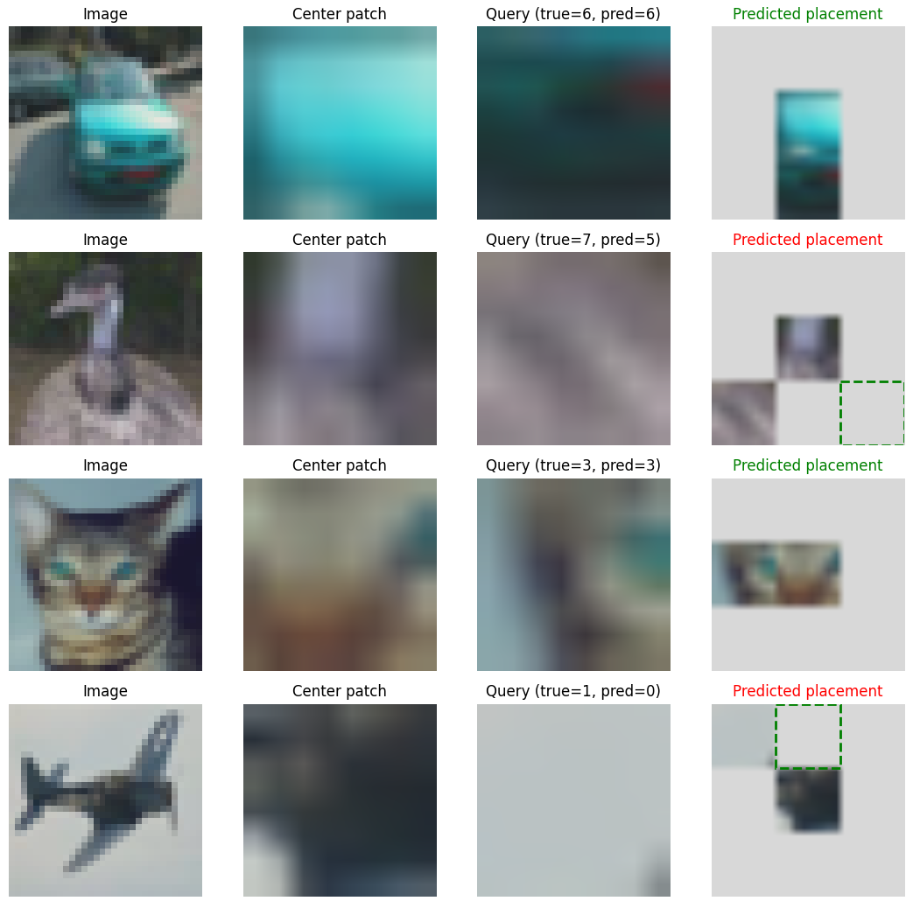
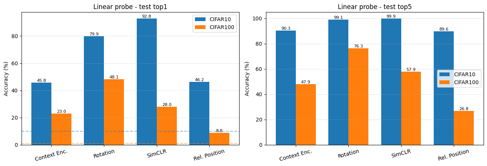

# Self-supervised image representation learning (CIFAR-10 / CIFAR-100)

TP for the M2 VMI course (Université Paris Cité, 2026/2027). Built on the
[`cs294-158-ssl`](https://github.com/wilson1yan/cs294-158-ssl) library (`deepul_helper`).

We compare four pretext tasks, each evaluated with a **linear probe** (linear classifier on frozen features, test top-1 / top-5):

- **Context encoder**: inpainting of the central region
- **Rotation prediction**: predict one of 4 rotations
- **SimCLR**: contrastive learning (NT-Xent)
- **Relative patch position** (Doersch et al., 2015, [arXiv:1505.05192](https://arxiv.org/abs/1505.05192)): implemented here

## Relative patch position

A central 8×8 patch and a neighbouring patch (one of 8 positions) go through a shared CNN encoder; an MLP head predicts the position (8-way classification). To avoid trivial shortcuts (e.g. chromatic aberration) we use a 2-pixel gap between patches, ±1 pixel jitter, and colour dropping. For the linear probe, the encoder is applied to the whole image.



*Examples: image, reference patch, neighbouring patch, true and predicted position.*

## Results (linear probe, test set)

| Dataset   | Method                   | Top-1 (%) | Top-5 (%) | Epochs |
|-----------|--------------------------|-----------|-----------|--------|
| CIFAR-10  | Context encoder          | 45.77     | 90.29     | 200*   |
| CIFAR-10  | Rotation                 | 79.91     | 99.12     | 200*   |
| CIFAR-10  | SimCLR                   | **92.84** | 99.86     | 200*   |
| CIFAR-10  | Relative position (ours) | 46.18     | 89.63     | 30     |
| CIFAR-100 | Context encoder          | 22.99     | 47.86     | 15     |
| CIFAR-100 | Rotation                 | **48.13** | 76.28     | 15     |
| CIFAR-100 | SimCLR                   | 28.03     | 57.92     | 15     |
| CIFAR-100 | Relative position (ours) | 8.81      | 26.84     | 30     |

\* Checkpoints provided with the TP, not retrained.

**Caveats:** training budgets differ across rows, so the comparison is not like-for-like. SimCLR on CIFAR-100 had not converged. The test set doubles as validation. CIFAR-100 has the same image source as CIFAR-10, so the domain shift is small.



## Files

- `selfsupervised_demos.ipynb`: demos, CIFAR-100 runs, comparison table/plot, relative-position visualisation
- `deepul_helper/tasks/relative_position.py`: the new pretext task
- `deepul_helper/data.py`, `deepul_helper/demos.py`, `train_self_supervised_task.py`: patched to support CIFAR-100 and `relative_position`
- `deepul_helper/tasks/{rotation,simclr}.py`: patched to accept CIFAR-100

## Usage

```bash
pip install requests opencv-python git+https://github.com/ildoonet/pytorch-gradual-warmup-lr.git
python train_self_supervised_task.py -d cifar10  -t relative_position -e 30
python train_self_supervised_task.py -d cifar100 -t relative_position -e 30
```

Tasks (`-t`): `context_encoder`, `rotation`, `simclr`, `relative_position`. Datasets (`-d`): `cifar10`, `cifar100`.
Checkpoints are saved to `results/{dataset}_{task}/`.
